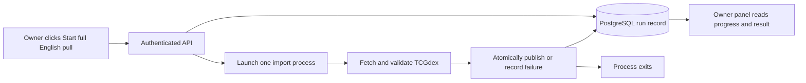

# Control-panel catalog imports on demand

**Status:** implemented and locally integration-validated; production validation pending.

**Implementation ticket:** [19 — Control-panel catalog imports on demand](../issues/19-manual-catalog-import-command.md)

**Decision:** [ADR 0003](../../../docs/adr/0003-on-demand-catalog-imports.md)

## Goal

Keep the owner's Start full English pull control and durable import progress, while removing the continuously running process that polls PostgreSQL for jobs every five seconds. One import process is started when the owner requests a pull, executes that particular run, and exits. Between imports, there is no catalog worker process.

This replaces the earlier terminal-only proposal. The browser remains the normal way to start an import.

## Owner workflow

1. The owner opens Owner controls and clicks Start full English pull.
2. The authenticated API creates a durable run and launches one background import process for its run ID.
3. The response returns promptly with the run ID and current status; the request does not wait for fetching or publication.
4. The panel displays phase, enumerated/fetched/validated counts, start/completion times, last success, and sanitized errors. The start control is disabled while a healthy run is active.
5. The owner may close the browser and return later. The process continues independently and saves its result in PostgreSQL.
6. On completion or failure, the import process closes its resources and exits. Another full pull requires another explicit owner action.

## API and launcher

Keep `POST /api/admin/catalog-runs`, its generated client, and the owner-only authorization checks. A repeated start while one healthy run is active returns that run and does not launch another process.

Use a small launcher boundary that accepts a server-generated run ID. The local implementation starts a Python entry point such as `python -m app.catalog_import --run-id <UUID>` with the current interpreter, fixed argument list, and explicit working directory. Never invoke a shell, accept executable paths from clients, or pass secrets in command arguments.

The child has its own database connection and receives the required server environment. It is detached from the HTTP request and browser lifetime; on the supported local macOS/Linux setup it must also survive an API-process restart. Output goes to bounded, sanitized application logging or a nonblocking sink, never an undrained pipe. Reap completed child processes without a permanent job-polling loop.

Do not run the full import synchronously in a request, a FastAPI background callback, or an API thread. Those choices couple a long import to the API process's lifetime.

The launcher reports a launch failure immediately. Mark the reserved run failed with a safe error and return `503` with stable code `CATALOG_DISPATCH_FAILED`; the owner can retry. A process ID is diagnostic only, never proof of execution or durable ownership. Successful process creation is not proof that the import succeeded.

The child claims exactly the supplied run ID. It must not search for other queued jobs or wait for future work. Missing, completed, superseded, or invalid run IDs exit without fetching. A duplicate child that cannot acquire ownership exits without changing the legitimate run's state.

## Concurrency and startup recovery

Serialize start requests across API processes through PostgreSQL. Reserve the run before launching its child and retain the unique one-active-run constraint. Keep an explicit bounded startup window of two minutes so repeated clicks or slow process startup do not create extra launches.

The import process acquires the existing PostgreSQL session advisory lock before fetching. It holds that lock on an open connection through fetching, validation, and publication, including across transaction commits. At most one importer may fetch or publish against a database. Lease expiration alone never authorizes a concurrent importer.

A new Start request follows these rules under dispatch serialization:

- If a runner owns the catalog lock, or the reserved run is still within its startup window, return the active run without spawning another child.
- If the startup window expired and no runner owns the catalog lock, the API may acquire exclusive catalog ownership, close the abandoned run as failed/interrupted, reserve a replacement, and launch it.
- Keep the recovery decision and run replacement protected from delayed children. A delayed child must revalidate that its supplied run is still unfinished and current after acquiring the runner lock; otherwise it exits without fetching.

Reusing an expired run is not required: preserve its record and start a fresh run. No timer, status read, or worker automatically retries an abandoned run. GET status may show an old-heartbeat warning, but does not start processes or change ownership.

## Import safeguards

Reuse the existing importer, bounded fetch concurrency, per-request retry/backoff, double enumeration, completeness/reference/variant validation, source-count and configured capacity gates, immutable Card Printing/Card Edition identity, conservative Card Identity and Basic Energy classification, owner review records, and private raw-generation retention.

Publication remains one PostgreSQL transaction that records the complete generation, active revision, last-success time, and successful run outcome together. A failed fetch, invalid source data, interruption, or publication failure preserves the previous active catalog. A failed first import leaves search unavailable. No import changes the identity or placement of Holdings.

Safe refresh and reconciliation requirements not yet implemented remain scoped to [ticket 14](../issues/14-safe-catalog-refresh-and-reconciliation.md). This execution-model change does not complete that ticket.

## Failure and process lifetime

Normal success returns process exit code `0`. Ordinary failure returns `1`, lock contention returns `2`, and Ctrl+C returns `130`. Record a safe terminal outcome when possible before exiting. Do not expose credentials, OTPs, account emails, source payloads, or raw exceptions in logs or the panel.

An abrupt kill, host shutdown, database outage, or deployment that terminates the execution environment may prevent recording failure. The runner lock is released when its database connection closes. The panel keeps durable progress and shows a stale-heartbeat warning; the owner's next Start request performs the guarded recovery described above. Restart fetching from the beginning rather than resuming partial records.

A successful publication committed before process death remains successful. Recovery must never relabel a committed successful run as interrupted.

Closing the browser does not stop the process. Stopping the entire host/container environment can stop it; this proposal does not promise execution across machine shutdown or deployment destruction.

## Startup and deployment

Normal local startup needs PostgreSQL, the API, authentication gateway, and frontend only. Remove the permanently polling `app.catalog_worker` entry point and README instructions that require running it.

Docker Compose continues to run PostgreSQL only. Do not add Redis, a message broker, a scheduler, or an idle catalog worker container. Database records preserve progress and concurrency; they are not consumed by a permanently polling queue worker.

The local launcher assumes a host capable of starting a detached Python process. Provider selection must verify that capability or supply an equivalent on-demand job launcher before deployment. A serverless request environment that kills child processes after requests is not sufficient. No hosting provider is selected by this change.

## Acceptance checks

Use a disposable real PostgreSQL database and deterministic source fixtures; CI does not require a live full English pull.

- Normal startup creates no catalog worker process and does not repeatedly query for queued catalog jobs.
- A browser click starts one real import child; the POST returns while a deliberately paused child is still running, and the panel shows its durable progress.
- A non-owner or unauthenticated caller cannot reserve runs or launch processes.
- Concurrent/repeated starts return one active run and launch one process, including the two-minute startup window. A duplicate child never fetches or overwrites its legitimate counterpart.
- Closing the browser and restarting the API do not stop a launched local import; reopening the panel shows its result.
- Each child handles only its supplied run ID and exits after a terminal result; no idle loop remains.
- Process-launch failure, crash between reservation and launch, child startup failure, delayed child, and abrupt process death recover safely on a later explicit Start.
- Recovery never overlaps a live importer even if its heartbeat is old, and never changes a committed success to failure.
- Failed fetch, invalid/changing source enumeration, source-count/capacity rejection, and injected publication failure preserve the active catalog and revision.
- Stable identities, raw-generation retention, review/approval, collector reads, and revision-bound search retain their existing contracts.
- Generated clients, TypeScript checks, build, and the full CI gate pass. Deployment documentation states the launcher capability required of the eventual host.

## Related requirements

This preserves the approved owner's frontend dispatch and browser-independent execution requirements. It refines the execution model to start one short-lived process per requested import. [ADR 0003](../../../docs/adr/0003-on-demand-catalog-imports.md) and ticket 19 supersede the continuously polling runner behavior implemented in ticket 02. Provider selection, operational status, and the owner-only launch gate must account for the on-demand launcher.
